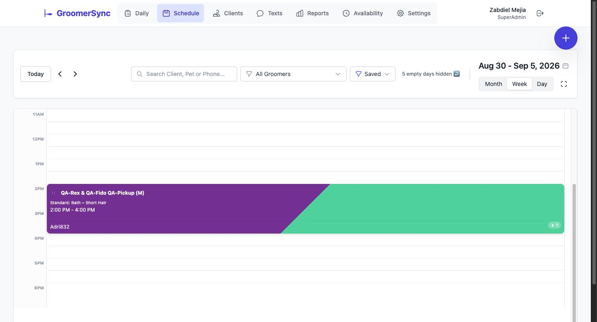
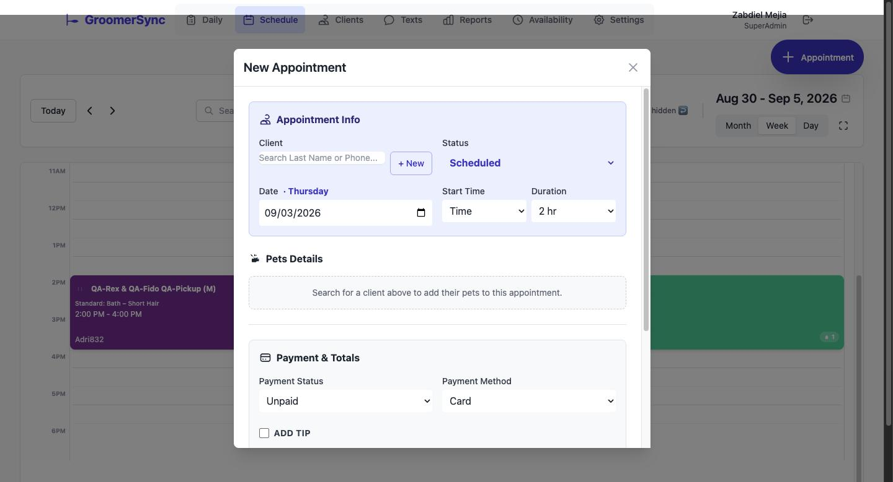
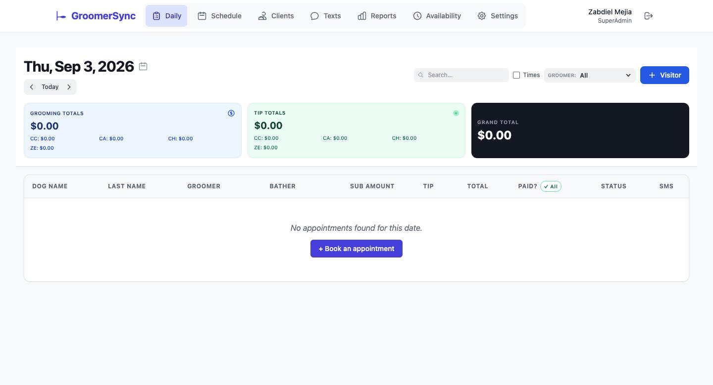
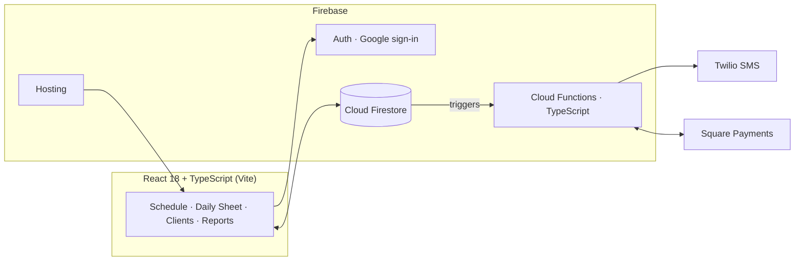

# GroomerSync — Case Study

**A production scheduling system for a real pet-grooming shop.** GroomerSync runs the day-to-day operations of AJ's Pet Grooming in Los Angeles — appointments, recurring bookings, client/pet records, SMS notifications, payments reconciliation, and financial reporting. It has been the shop's live system of record since July 2026.

> **Why a case study and not the code?** GroomerSync is a working commercial system for a real business, so the source stays private. This repo documents what was built and how it's engineered. **A full code walkthrough is available on request in interviews** — and my public Playwright work is at [Playwright-Demo-Sauce](https://github.com/ZabdielMej/Playwright-Demo-Sauce).

Built and operated solo, in an AI-assisted workflow (Claude Code) with human review gates — PR flow, code review, verification before completion.

---

## Screenshots

*Staging environment, synthetic data.*

| Schedule — week view | Booking form |
|---|---|
|  |  |

*The Daily Sheet — the shop-floor view: income tiles (card/cash/check split, tips tracked separately) over today's appointment table with inline status, payment, and SMS controls.*

---

## What it does

- **Schedule** — day / week / month / list views with drag-and-drop rescheduling and color-coded groomers.
- **Recurring appointments** — the shop's core feature: weekly/monthly series, "this one only" vs. "all in series" edits, per-instance exceptions, closed-day conflict handling.
- **Daily Sheet** — today's operations: inline status, price, payment, and groomer edits, plus walk-in intake.
- **Clients & Pets** — full CRUD, CSV import/export, format-agnostic phone search, archive-instead-of-delete, per-pet grooming-note history.
- **SMS notifications (Twilio)** — booking confirmations, reminders, and pickup texts, with an in-app activity log, resend flow, per-shop kill switch, and dry-run mode outside production.
- **Money** — daily income tiles, card-charge reconciliation against Square, expense tracking, profit snapshots, per-pet groomer commission payroll.
- **Role-based access** — seven roles with an editable permission matrix, enforced in the UI *and* in Firestore security rules.
- **Audit log** — meaningful mutations recorded and viewable per client.

## Architecture

**Highlights** (the full decision log lives in the private repo's `docs/DECISIONS.md`):

- **Multi-tenant data model** — every document is scoped to a shop, enforced by security rules; a single shop today, multi-location ready without a data migration.
- **Security rules as a first-class artifact** — default-deny Firestore rules, tested like code against the emulator; the rules test suite is the deploy gate for any rules change.
- **Timezone-anchored scheduling** — appointments anchor to the shop's timezone regardless of the viewer's locale; configurable shop hours and an admin-editable closures table drive booking conflict checks.
- **Domain-driven decisions** — e.g. double-booking is *intentionally allowed* as a capacity buffer, a rule that came from the shop owner, not a missing feature.
- **Serverless SMS pipeline** — bilingual templates, idempotent sends (retries never double-text a client), and a dry-run mode that keeps staging from ever texting real customers.
- **Operational safety** — archive-first deletes, write sanitization, and E2E tests that refuse to run against the production project.

## Tech stack

| Layer | Choice |
|---|---|
| Frontend | React 18 + TypeScript (strict) |
| Build | Vite |
| Styling | Tailwind CSS |
| Backend | Firebase — Auth, Firestore, Cloud Functions (TypeScript), Hosting |
| SMS | Twilio (Secret Manager credentials, signature-validated webhook) |
| Payments | Square (reconciliation) |
| Testing | Vitest, @firebase/rules-unit-testing, Playwright, AI-driven scenario suite |
| CI | GitHub Actions |

## Testing — four layers, all in CI

1. **Unit (Vitest)** — 440+ tests across 20+ suites covering the pure-logic core: recurrence, pricing, commissions, daily totals, reconciliation, SMS templating, role permissions.
2. **Firestore rules tests** — ~96 emulator-backed tests asserting per-role allow/deny and cross-shop isolation. Deploy gate for rules changes.
3. **Playwright E2E** — deterministic browser specs run in CI against the staging deploy.
4. **AI-driven scenario suite** — scenarios written as semantic Action/Expect markdown that an AI agent executes in a real browser, judging assertions by meaning rather than selectors (zero selector maintenance). Each run renders a markdown/JSON report into an HTML dashboard. Across its runs this suite caught **7 real pre-existing bugs** — including a silent data-loss save path and a revenue omission in daily cash totals — all fixed and re-verified in-run.

CI runs type-check, unit tests, app + functions builds, and emulator-backed rules tests on every push and PR.

## Production story

- Shipped to production July 2026 on Firebase Hosting; the shop has run on it daily since.
- Staged rollout: staging environment with SMS dry-run → production cutover with rules/index deploys, data purge, and role-seeded staff roster → live smoke verification.
- Since launch: Square payment reconciliation, expense/profit reporting, and payroll commissions shipped as post-launch iterations through the same PR + review + CI pipeline.

---

## About me

**Zabdiel Mejía** — Senior QA Automation Engineer (9+ years) who also ships production software.

- LinkedIn: [linkedin.com/in/zabdiel-mejia](https://www.linkedin.com/in/zabdiel-mejia)
- GitHub: [@ZabdielMej](https://github.com/ZabdielMej)
- Public automation work: [Playwright-Demo-Sauce](https://github.com/ZabdielMej/Playwright-Demo-Sauce)
- Email: zabdield.mejiaa@gmail.com

*Code walkthrough, architecture deep-dive, or a live demo of the app — happy to do any of them in an interview.*
