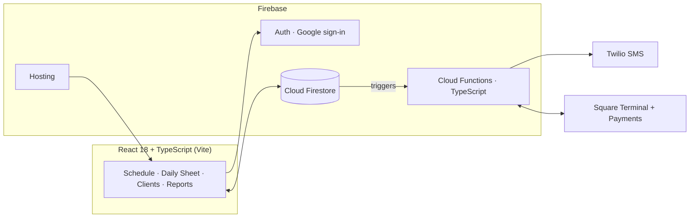

# GroomerSync: Case Study

**A production scheduling and operations system for a real pet-grooming shop.** GroomerSync runs the day-to-day of AJ's Pet Grooming in Los Angeles: appointments, recurring bookings, client and pet records, SMS, card payments on a Square Terminal, refunds and chargebacks, payroll commissions and financial reports. It has been the shop's live system of record since July 2026, used every day on the shop iPad.

> **Why a case study and not the code?** GroomerSync is a working commercial system for a real business, so the source stays private. This repo documents what was built and how it is engineered. **A full code walkthrough is available on request in interviews.** My public Playwright work is at [Playwright-Demo-Sauce](https://github.com/ZabdielMej/Playwright-Demo-Sauce).

Built and operated solo. The code is written with AI coding agents (Claude Code) under QA gates I set and enforce: stories with named tests before code, an independent automated review on every PR, CI only after review, staging before production.

---

## By the numbers (as of October 28, 2026)

| | |
|---|---|
| In production | since July 2026, daily use |
| Development | March 2026 to today, 382 commits on main |
| Pull requests merged | 177, every one through automated review and CI |
| User stories written | 115, each with acceptance criteria and tests named before code |
| Unit tests (Vitest) | 2,086 across 123 files |
| Firestore security-rules tests | 245, emulator-backed, the deploy gate for any rules change |
| Playwright touch tests | 185 cases, each run on iPad WebKit, iPhone WebKit and desktop Chromium |
| AI-driven scenario files | 40, executed in a real browser against staging |
| Cloud Functions | 16 (SMS, Square Terminal, refunds, disputes, receipts, health, scheduled sweeps) |

---

## Screenshots

*Staging environment, synthetic data.*

| Schedule, week view | Booking form |
|---|---|
|  |  |

*The Daily Sheet, the shop-floor view: income tiles (card, cash, check and Zelle split, tips tracked separately) over today's appointment table with inline status, payment, Terminal and SMS controls.*

---

## What it does

- **Schedule.** Day, week, month and list views with drag-and-drop rescheduling and color-coded groomers.
- **Recurring appointments.** The shop's core feature: weekly and monthly series, "this one only" vs "all in series" edits, per-instance exceptions, closed-day conflict handling.
- **Daily Sheet.** Today's operations: inline status, price, payment, groomer and tip edits, walk-in intake, retail sales.
- **Square Terminal.** Charge a visit from the row and the card reader wakes up; the payment is matched back to the visit, with a reconcile sweep for charges Square finished late. Refunds with server-side caps and idempotency, chargeback alerts that block a refund while a dispute is open, and receipts printed or shown on the device after the fact.
- **Clients and pets.** Full records, CSV import and export, phone search in any format, archive instead of delete, per-pet grooming-note history.
- **SMS (Twilio).** Booking confirmations, reminders and pickup texts in English and Spanish, an in-app activity log, resend flow, per-shop kill switch, dry-run mode outside production. A second, hosted shop line for holiday offers with a public consent page, carrier (A2P 10DLC) registration and consent records per phone number.
- **Money.** Daily income tiles, Square reconciliation per day, expense tracking, profit snapshots, per-pet groomer commission payroll with an "unpaid in this range" check before the checks are written.
- **System Health.** Job heartbeats, recent failures and a 24-hour activity view so a quiet failure in a scheduled sweep is visible before it costs money.
- **Role-based access.** Seven roles with an editable permission matrix, enforced in the UI and in Firestore security rules.
- **Audit log.** Every data change is recorded and viewable per client; money writes carry their own log entries.

## Architecture

**Highlights** (the full decision log lives in the private repo):

- **Multi-tenant data model.** Every document is scoped to a shop, enforced by security rules. One shop today, multi-location ready without a data migration.
- **Security rules as a first-class artifact.** Default-deny Firestore rules, tested like code against the emulator. The rules suite is the deploy gate for any rules change.
- **Money paths built like money paths.** Payment-state writes go through a transaction helper that rebuilds the patch from the live document, so two devices cannot overwrite each other.  Refund caps and idempotency keys live server-side. Terminal state machines have a reconcile sweep for the ambiguous cases (network timeouts, late captures).
- **Core, logic, wiring.** Cloud Functions are split into import-free cores with ports, thin logic modules and the Firebase wiring, so the hard parts run under unit tests with fakes and the architecture test refuses a core that imports the SDK.
- **Timezone-anchored scheduling.** Appointments anchor to the shop's timezone regardless of the viewer's locale; configurable shop hours and an admin-editable closures table drive conflict checks.
- **Domain-driven decisions.** Double-booking is intentionally allowed as a capacity buffer, a rule that came from the shop owner, not a missing feature.
- **Serverless SMS pipeline.** Bilingual templates, idempotent sends (retries never double-text a client), signature-validated webhooks, and a dry-run mode that keeps staging from ever texting real customers.
- **Operational safety.** Archive-first deletes, write sanitization, and test suites that refuse to run against the production project.

## Tech stack

| Layer | Choice |
|---|---|
| Frontend | React 18 + TypeScript (strict) |
| Build | Vite |
| Styling | Tailwind CSS |
| Backend | Firebase: Auth, Firestore, Cloud Functions (TypeScript), Hosting |
| SMS | Twilio (Secret Manager credentials, signature-validated webhooks, hosted number, A2P 10DLC) |
| Payments | Square Terminal API (checkouts, refunds, disputes, receipts) and Payments reconciliation |
| Testing | Vitest, @firebase/rules-unit-testing, Playwright, emulator smoke suites, AI-driven scenario suite |
| Review and CI | Codex automated review on every PR, GitHub Actions |

## How it is built

1. **Stories first.** Every feature is split into small user stories with acceptance criteria, the files it will touch, a production-data impact section, and **the tests named before the code**.
2. **Tests fail first, then pass.** Unit, rules, touch and emulator smoke suites green locally before anything is pushed.
3. **Independent review.** Every PR goes to an automated reviewer, round after round, until it comes back clean. Findings are triaged on their merits; a wrong finding is answered, a right one is fixed with a test that fails first.
4. **CI only after review.** CI runs once review is clean, which keeps Actions minutes down and makes every green build count.
5. **Design gates.** Any visible change gets three options on a mockup before code, judged against a written anti-pattern list, so the shop's iPad never gets an untested layout.
6. **Owned releases.** Staging first, then production, with a deploy checklist, a rollback path, and an incident log (including a Google-side Cloud Run outage in October 2026 and the fallbacks that kept the shop charging cards).

Recent catches by that process before they shipped: a refund that could exceed its cap after a network timeout, a refund that could go out while a chargeback was open, a payroll "mark paid" that could reclassify card revenue as cash if two devices raced, and seven scheduled-job failure paths that resolved quietly instead of reaching the health heartbeat.

## Testing, five layers

1. **Unit (Vitest).** 2,086 tests over the pure-logic core: recurrence, pricing, commissions, daily totals, reconciliation, Terminal state machines, refund caps, SMS templating, role permissions, CSV exports.
2. **Firestore rules tests.** 245 emulator-backed tests asserting per-role allow and deny, cross-shop isolation, and the server-only fields a client may never write.
3. **Playwright touch tests.** 185 cases on iPad WebKit, iPhone WebKit and desktop Chromium, against harness pages that mount the real components with fake data, so 44px targets, pop-overs and keyboard paths are pinned on the device that uses them.
4. **Emulator smoke suites.** Deployed-shape checks of the Cloud Functions against the Firebase emulators (SMS, calendar, Terminal, retail), several hundred checks per run.
5. **AI-driven scenario suite.** Scenarios written as Action and Expect markdown that an AI agent executes in a real browser against staging, judging assertions by meaning rather than selectors. Across its runs this suite caught 7 real pre-existing bugs, including a silent data-loss save path and a revenue omission in daily cash totals, all fixed and re-verified.

## Production story

- Shipped to production July 2026 on Firebase Hosting; the shop has run on it daily since.
- Staged rollout: staging with SMS dry-run, then production cutover with rules and index deploys, data purge, and a role-seeded staff roster, then live smoke verification.
- Since launch, through the same story, review and CI pipeline: Square Terminal charging, refunds and chargeback handling, receipts, payroll checks, System Health, a hosted second phone line with carrier registration, and a public holiday-texts sign-up site.

---

## About me

**Zabdiel Mejía**, Senior QA Automation Engineer (9+ years) who also ships production software.

- LinkedIn: [linkedin.com/in/zabdiel-mejia](https://www.linkedin.com/in/zabdiel-mejia)
- GitHub: [@ZabdielMej](https://github.com/ZabdielMej)
- Public automation work: [Playwright-Demo-Sauce](https://github.com/ZabdielMej/Playwright-Demo-Sauce)
- Email: zabdield.mejiaa@gmail.com

*Code walkthrough, architecture deep-dive, or a live demo of the app: happy to do any of them in an interview.*
